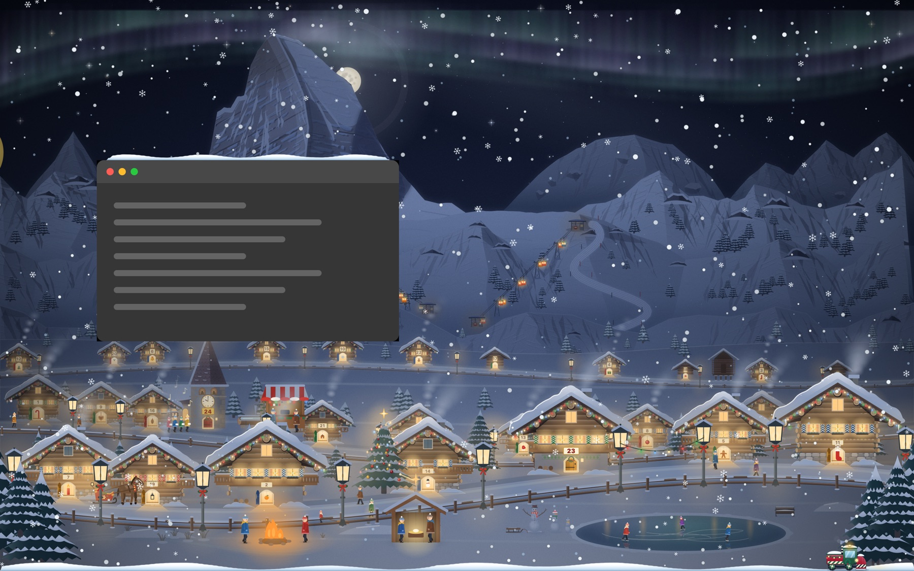
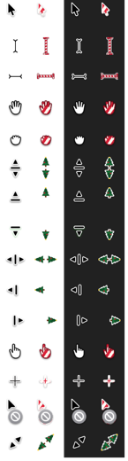

<p align="center">
  
</p>

<p align="center">
  <a href="../../releases/latest"><b>⬇︎ Download Schneetag</b></a>
  &nbsp;·&nbsp; macOS 14 or later &nbsp;·&nbsp; Apple silicon and Intel &nbsp;·&nbsp; free and open source
</p>

# Schneetag

Schneetag (German for "snow day") makes it snow on your Mac. Flakes drift across your desktop, settle on the top edges of your windows and slide off when you move a window. A little snowplough clears the ground at the bottom of the screen. Push the snow together to roll snowballs, stack them into snowmen and let them fight it out in a snowball fight.

In **Christmas mode**, a snowy alpine village beneath the Matterhorn appears behind your windows – with an Advent calendar of 24 doors that each open only on their day in December.

Your windows always stay clear: the snow and the village live only on the visible desktop, and clicks pass straight through.

<p align="center">
  
</p>

## Installation

1. Download **Schneetag.zip** from [Releases](../../releases/latest) and open it.
2. Drag **Schneetag** into your **Applications** folder.
3. Open Schneetag. On first launch macOS warns that the app is not from an identified developer – Schneetag is a free project without a paid Apple developer signature. To open it anyway:
   - Go to **System Settings › Privacy & Security**, scroll down and click **Open Anyway** next to Schneetag.
   - Or run this in Terminal:
     ```bash
     xattr -dr com.apple.quarantine /Applications/Schneetag.app
     ```
4. A small snowman appears in the menu bar at the top right. Everything is in its menu.

> The app's interface is in German. The menu items are translated in the table under [Usage](#usage).

## Features

### Snow that settles
- Three layers of falling snow in three strengths; the back layer keeps falling behind your windows.
- Snow piles up on window edges and on the ground. Move or shake a window and it slides off.
- Push snow around with the mouse pointer. Keep pushing and it packs into a snowball that grows as it rolls.
- A little snowplough clears the ground; when a lot of snow builds up, a big snow blower lends a hand.
- macOS notifications get a layer of frost that trickles down when you close them.

### Snowmen and snowball fights
- Click a snowball to pick it up and stack it: three balls make a snowman, each with its own hat, face and personality.
- With two snowmen on the same screen, start a snowball fight from the menu. The last one standing gets a crown.

### Alpine village with Advent calendar
- A high valley with the Matterhorn, chalets, a church, a cable car, a ski run and a frozen lake. The sky follows your Mac's clock: sun, alpenglow, moon and stars.
- **24 doors** are hidden around the village. Each one opens only on its day in December and immediately brings something new to the village: a horse-drawn sleigh, lanterns, fairy lights, the village tree, the cable car, a Christmas market, a choir, the northern lights – and on the 24th the whole valley lights up.
- From door 6 on, **Rudolph** drops by; from door 23, **Santa** arrives with his sleigh, lands on window edges and leaves presents you can open with a click.

<p align="center">
  
  
</p>

### Festive mouse pointers
In Christmas mode your mouse pointer gets dressed up: a candy-cane arrow or a peppermint, a candy-cane text cursor, fir trees for resizing windows and striped hands. Pick a style or switch it off under **Weihnachtszeiger** in the menu.

<p align="center">
  
</p>

## Usage

Everything is in the snowman menu at the top right:

| Menu item | English | What it does |
|---|---|---|
| Steuerung öffnen … | Open controls … | Window with all settings |
| Schnee pausieren | Pause snow | Stops the snow, e.g. during demanding work |
| Schneefall | Snowfall | Light, normal or heavy |
| Schneepflug | Snowplough | Turns the plough on or off |
| Frost auf Mitteilungen | Frost on notifications | Frost on macOS notifications |
| Weihnachtsmodus | Christmas mode | Village, Advent calendar, visitors and festive pointers |
| Weihnachtszeiger | Festive pointer | Candy cane, peppermint or the normal pointer |
| Schneeballschlacht starten | Start snowball fight | Available with two finished snowmen |
| Schneemänner entfernen / Schnee wegfegen | Remove snowmen / Sweep away snow | Resets everything |

Optional: if you allow Schneetag under **Accessibility**, it recognises the icons on your desktop and never places snow or doors on top of them.

## Performance and privacy

- Schneetag draws at 60 frames per second so the snow falls smoothly. On an Apple silicon Mac that takes about half a CPU core – Activity Monitor shows roughly 40 %, which it counts per core. With **Schnee pausieren** (pause snow) it uses practically nothing.
- Schneetag has no network access and collects no data. It only stores your settings, your snowmen and the doors you have opened – locally on your Mac.

## Building from source

You need macOS 14 or later and the Xcode Command Line Tools (`xcode-select --install`).

```bash
./build.sh                  # builds build/Schneetag.app for your Mac
UNIVERSAL=1 ./build.sh      # for Apple silicon and Intel at once
./Tests/run.sh              # checks snow physics, windows, calendar and pointers
```

Schneetag is plain Swift with AppKit and Core Graphics – no dependencies. The app icon is generated with `swift tools/make-icon.swift icon.png`.

## Contributing

Found a bug or have an idea? Feel free to open an [issue](../../issues) or a pull request. Please run `./Tests/run.sh` before sending a pull request.

## License

Schneetag is released under the [MIT License](LICENSE): you are free to use, modify and share it.
