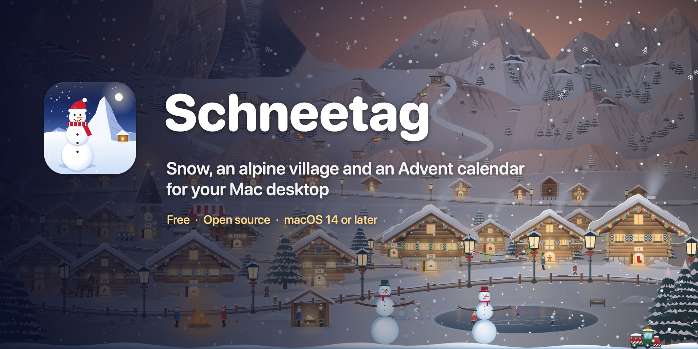
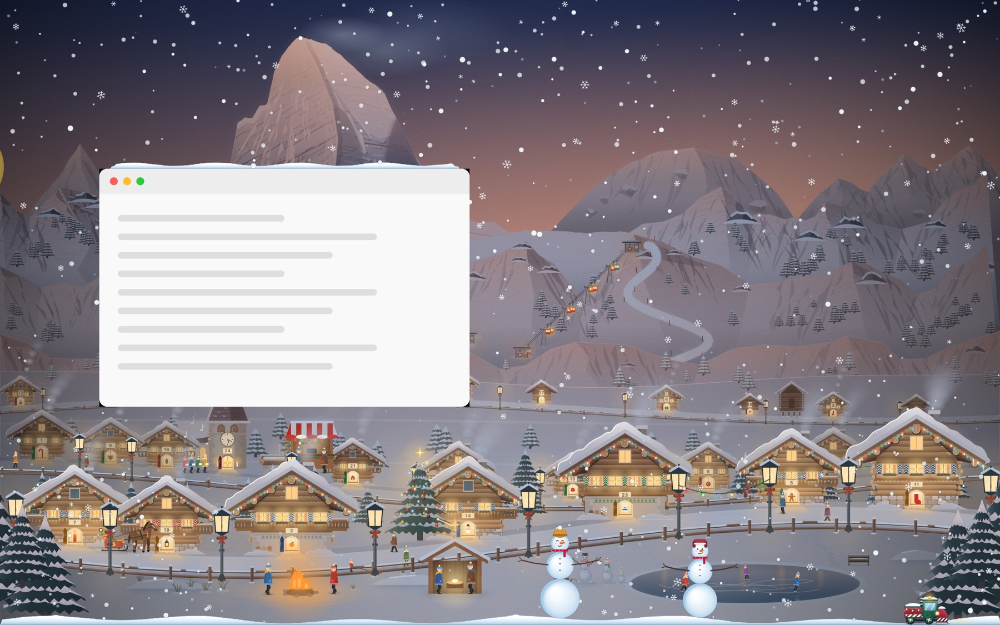
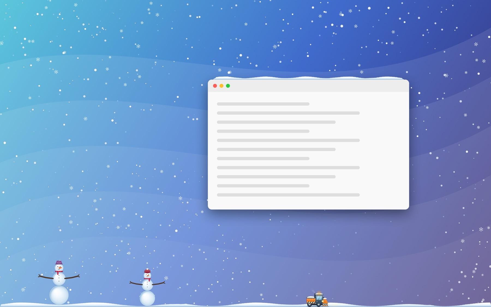
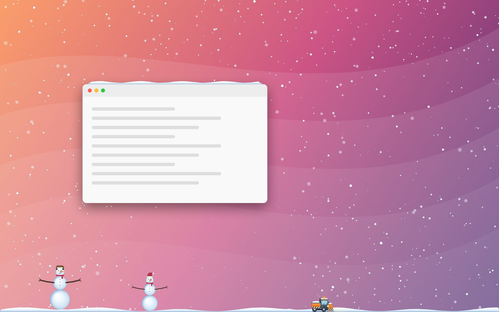
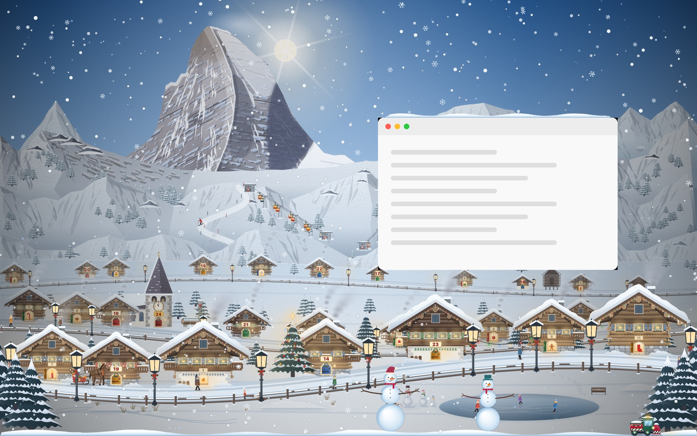
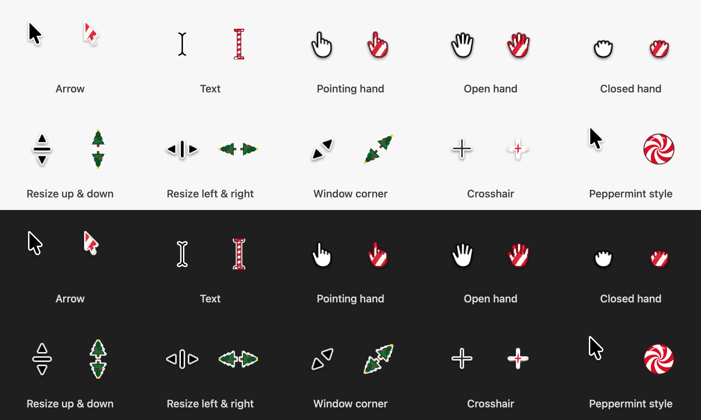

<p align="center">
  
</p>

<p align="center">
  <a href="../../releases/latest"><b>⬇︎ Download Snow Day</b></a>
  &nbsp;·&nbsp; macOS 14 or later &nbsp;·&nbsp; Apple silicon and Intel &nbsp;·&nbsp; free and open source
</p>

# Snow Day

Snow Day makes it snow on your Mac. Flakes drift across your desktop, settle on the top edges of your windows and slide off when you move a window. A little snowplow clears the ground at the bottom of the screen. Push the snow together to roll snowballs, stack them into snowmen and let them fight it out in a snowball fight.

In **Christmas Mode**, a snowy alpine village beneath the Matterhorn appears behind your windows – with an Advent calendar of 24 doors that each open only on their day in December.

Christmas Mode is optional: without it, Snow Day keeps **your own desktop picture** and simply lets it snow on top.

Your windows always stay clear: the snow and the village live only on the visible desktop, and clicks pass straight through.

<p align="center">
  
</p>

## Installation

1. Download **SnowDay.zip** from [Releases](../../releases/latest) and open it.
2. Drag **Snow Day** into your **Applications** folder.
3. Open Snow Day. On first launch macOS may warn that the app is not from an identified developer. To open it anyway:
   - Go to **System Settings › Privacy & Security**, scroll down and click **Open Anyway** next to Snow Day.
   - Or run this in Terminal:
     ```bash
     xattr -dr com.apple.quarantine "/Applications/Snow Day.app"
     ```
4. A small snowman appears in the menu bar at the top right. Everything is in its menu.

## Features

### Snow that settles
- Three layers of falling snow in three strengths; the back layer keeps falling behind your windows.
- Snow piles up on window edges and on the ground. Move or shake a window and it slides off.
- Push snow around with the mouse pointer. Keep pushing and it packs into a snowball that grows as it rolls.
- A little snowplow clears the ground; when a lot of snow builds up, a big snow blower lends a hand.
- macOS notifications get a layer of frost that trickles down when you close them.

### Snowmen and snowball fights
- Click a snowball to pick it up and stack it: three snowballs make a snowman, each with its own hat, face and personality.
- With two snowmen on the same screen, start a snowball fight from the menu. The last one standing gets a crown.

### Your own wallpaper
Snow Day doesn't replace your desktop picture. With **Christmas Mode** off, you keep your own wallpaper and get everything else on top of it: falling snow, snow on your windows, snowmen, snowball fights, the snowplow and frost on notifications.

You can also keep Christmas Mode on and just turn off **Winter Village with Advent Calendar** – then your own wallpaper stays and you still get the Christmas touches like the festive pointers.

<p align="center">
  
  
</p>

### Alpine village with Advent calendar
- A high valley with the Matterhorn, chalets, a church, a cable car, a ski run and a frozen lake. The sky follows your Mac's clock: sun, alpenglow, moon and stars.
- **24 doors** are hidden around the village. Each one opens only on its day in December and immediately brings something new to the village: a horse-drawn sleigh, lanterns, fairy lights, the village tree, the cable car, a mulled wine stall, a children's choir, the northern lights – and on the 24th the whole valley lights up.
- From door 6 on, **Rudolph** drops by; from door 23, **Santa** arrives with his sleigh, lands on window edges and leaves presents you can open with a click.

<p align="center">
  
  
</p>

### Christmas pointers
In Christmas Mode your mouse pointer gets dressed up: a candy-cane arrow or a peppermint, a candy-cane text cursor, fir trees for resizing windows and striped hands. Choose a style – or the standard pointer – under **Christmas Pointer** in the menu.

<p align="center">
  
</p>

## Usage

Everything is in the snowman menu at the top right:

| Menu item | What it does |
|---|---|
| Open Controls… | Window with all settings |
| Pause Snow | Stops the snow, e.g. during demanding work |
| Snowfall | Light, Normal or Heavy |
| Snowplow | Turns the snowplow on or off |
| Frost on Notifications | Frost on macOS notifications |
| Christmas Mode | Village, Advent calendar, visitors and Christmas pointers – off keeps your own wallpaper |
| Winter Village with Advent Calendar | Shows or hides the village in Christmas Mode; off keeps your own wallpaper |
| Christmas Pointer | Candy Cane, Peppermint or Standard Pointer |
| Start Snowball Fight | Available once two snowmen are finished |
| Remove Snowmen / Sweep Away Snow | Resets everything |

Optional: if you allow Snow Day under **Accessibility**, it recognizes the icons on your desktop and never places snow or doors on top of them.

## Performance and privacy

- Snow Day draws at 60 frames per second so the snow falls smoothly. On an Apple silicon Mac that takes about half a CPU core – Activity Monitor shows roughly 40 %, which it counts per core. With **Pause Snow** it uses practically nothing.
- Snow Day has no network access and collects no data. It only stores your settings, your snowmen and the doors you have opened – locally on your Mac.

## Building from source

You need macOS 14 or later and the Xcode Command Line Tools (`xcode-select --install`).

```bash
./build.sh                  # builds "build/Snow Day.app" for your Mac
UNIVERSAL=1 ./build.sh      # for Apple silicon and Intel at once
./Tests/run.sh              # checks snow physics, windows, calendar and pointers
```

Snow Day is plain Swift with AppKit and Core Graphics – no dependencies. The app icon is generated with `swift tools/make-icon.swift icon.png`; signed and notarized releases are made with `tools/release.sh`.

## Contributing

Found a bug or have an idea? Feel free to open an [issue](../../issues) or a pull request. Please run `./Tests/run.sh` before sending a pull request.

## License

Snow Day is released under the [MIT License](LICENSE): you are free to use, modify and share it.
